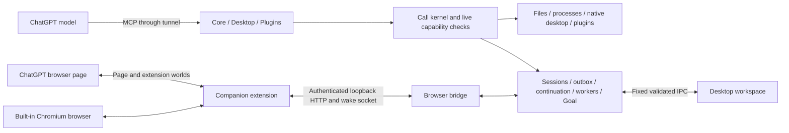

# Chat On Steroids: deep architecture and size scan v1.0

Date: **2026-10-16, Asia/Jakarta**. Scope: clone, static investigation, public release inspection,
and Rust migration phase assessment. This is not a completed Rust implementation or a live conformance run.

## Kesimpulan

Untuk scope **semua fitur dipertahankan**, pembagian yang direkomendasikan adalah **16 fase**.
Angka ini merupakan pembagian pekerjaan berdasarkan batas subsistem dan acceptance, bukan angka yang
otomatis ditentukan bahasa pemrograman. Roadmap lengkap ada di
[rencana fase](../implementation-plan/2026-10-16-rust-migration-phases-v1.0.md).

Ukuran installer Windows x64 adalah **173.637.457 byte / 173,64 MB / 165,59 MiB**.
Payload aplikasi di dalam arsipnya adalah **607.145.786 byte / 607,15 MB / 579,02 MiB**.
Electron/Chromium menyumbang **385.168.581 byte**, atau **63,44%** payload.
Mengganti backend saja sambil mempertahankan Electron tidak menghilangkan bagian terbesar ini.

Target yang masuk akal adalah Rust untuk pemilik state, tools dan aplikasi desktop, dengan keputusan
eksplisit tentang browser, interpreter JavaScript dan plugin eksternal. Klaim literal “tidak ada JavaScript,
Chromium, C/C++, Python, atau Node di seluruh ekosistem” bertentangan dengan sebagian fitur yang sekarang ada.

## Baseline yang dipindai

| Item | Identitas / hasil |
| --- | --- |
| Upstream | [totec448-spec/chat-on-steroids](https://github.com/totec448-spec/chat-on-steroids) |
| Clone | `D:\projects\CoS-Rust\upstream\chat-on-steroids` |
| Source branch | `main` |
| Source commit | `024731d8083d92c46e8248d64e7e0b36ab0a470f` |
| Commit time | `2026-10-16T16:16:20+02:00` / `2026-10-16 21:16:20 WIB` |
| Declared app / extension version | `2.1.39` / `2.1.39` |
| Browser bridge protocol | `14` |
| Latest release observed | [v2.1.39](https://github.com/totec448-spec/chat-on-steroids/releases/tag/v2.1.39) |
| Release commit | `87ae9d631f82d8da2f462d910410031ad8f97ac5` |
| Main compared with release | 87 commits ahead; 118 changed files in the pinned diff |
| License declared upstream | MIT; individual dependency licenses remain separate |

`main` already contains SSH projects and other changes after the released artifact. This report uses main
for future feature scope and the released Windows x64 artifact for actual package measurements. It does
not call those two snapshots identical. Receipts: [source identity](../../audit/2026-10-16/source-identity.json),
[release metadata](../../audit/2026-10-16/github-latest-release.json),
[main vs release diff](../../audit/2026-10-16/main-vs-release.diffstat.txt).

## Cakupan dan metode

Inventory hashes every Git-tracked file, including assets, tests, documentation, licenses and build tooling.
Structural extraction covers product code in `src`, `extension` and `native`. Twenty selected behavior
documents received a separate semantic pass. Source review focuses on authoritative owners, wire/storage
contracts, release assembly and high-risk state transitions. This does not mean every line of every file
was manually read or that every branch was executed.

| Measure | Result | Meaning |
| --- | ---: | --- |
| Git-tracked files | 1,442 | Full file inventory, not dependency installation |
| Tracked source tree bytes | 105,817,959 | Excludes `.git`, `node_modules`, generated output and user data |
| Product files: src + extension + native | 539 | Every file has a proposed owner in the migration map |
| Product code physical lines | 143,997 | Includes comments and blank lines; not semantic SLOC |
| All code physical lines | 315,389 | Includes tests, scripts and native code |
| Test files matching `*.test.ts` | 382 | Not a claim that tests ran |
| Lexical test declarations | 6,946 | Approximate static count; runtime parameterization can differ |
| Direct production dependencies | 27 | From package.json |
| Lockfile production records | 211 | Includes 59 optional records; not installed package count or size |
| Files importing Electron | 96 | Static regex inventory across tracked code |
| Literal IPC handler channels found | 149 | Includes the app's `handle()` wrapper; dynamic registrations can be absent |
| Literal durable ledger names found | 23 | Lower bound; excludes computed names |
| Capability flags / UI languages | 13 / 13 | Current declarations, not a proposed reduction |

Receipts: [inventory](../../audit/2026-10-16/inventory.json),
[contracts](../../audit/2026-10-16/contracts.json),
[file ownership map](../../audit/2026-10-16/migration-file-map.csv),
[test inventory](../../audit/2026-10-16/test-inventory.json).

## Bukti penyumbang ukuran

The public installer was downloaded, matched against its GitHub-published byte length and SHA-256, then
listed with 7-Zip. Only `resources/app.asar` was extracted for header inspection. The installer was never
run. These are **uncompressed archive file bytes**, not allocated filesystem space or runtime memory.

| Packaged category | Decimal MB | Payload share | Migration implication |
| --- | ---: | ---: | --- |
| Electron/Chromium runtime and root resources | 385.17 | 63.44% | Main opportunity: remove bundled Electron, decide browser runtime explicitly |
| `resources/app.asar` | 68.94 | 11.35% | Contains compiled app, renderer assets and production Node modules |
| Tunnel sidecars | 62.60 | 10.31% | `cloudflared.exe` 39.75 MB + `tunnel-client.exe` 22.59 MB, plus notices |
| Unpacked native Node modules | 48.26 | 7.95% | Sharp/libvips, PTY, tree-sitter and native bindings need parity-preserving replacements |
| Resource notices / miscellaneous | 31.14 | 5.13% | Includes an additional 20.47 MB Chromium notice copy; inspect legal-safe deduplication |
| ripgrep bundle | 4.60 | 0.76% | Already a useful Rust executable; preserve search semantics before embedding/replacing |
| Pets | 4.21 | 0.69% | Small; deleting them does not solve the main size problem |
| Extension | 2.22 | 0.37% | Small package footprint, substantial behavioral complexity |
| **Total** | **607.15** | **100%** | Windows x64 v2.1.39 only |

The ASAR contains **50.46 MB of packed Node-module content**, **14.55 MB renderer content**,
**2.90 MB main-process output**, **0.032 MB preload output**, and approximately 0.99 MB header.
Its header also references 48.26 MB unpacked native files; those are already counted separately above.
Do not double-count them. Some renderer libraries are both bundled for the UI and retained in dependency
trees; removal candidates need a whole-package reachability check before being called unused.

The 694.06 MB `Native-Sources.tar.gz` release asset is a separate corresponding-source distribution.
It is **not inside this installer** and must not be counted as installed application bloat.
The source inventory check passed for 730 pinned archives/patches; that is not a complete legal clearance.

Receipts: [installer verification](../../audit/2026-10-16/release-artifact-verification.json),
[payload buckets and all entries](../../audit/2026-10-16/package-size-breakdown.json),
[ASAR accounting](../../audit/2026-10-16/asar-size-breakdown.json),
[original archive listing](../../audit/2026-10-16/installer-archive-listing.txt).

## Arsitektur yang harus dipertahankan

There are three model-facing MCP surfaces, a separate browser bridge, and an optional local control API.
The renderer is a projection of authoritative main-process state. The extension observes provider chat
state and performs browser actions; it does not execute local model tools. The model still runs in the
provider's browser conversation. A Rust rewrite must preserve these boundaries while changing their hosts.

| Owner | Current entry points | Contracts that a port can easily break |
| --- | --- | --- |
| Permissions / config / credentials | `config.ts`, `sandbox.ts`, `secrets.ts`, `durable.ts`, `shared/types.ts` | Current grants at use, canonical approved roots, conservative corrupt-config recovery, OS-protected encryption, durable-before-ACK publication |
| MCP / code mode | `mcp/server.ts`, `surfaces.ts`, `kernel.ts`, `code-mode-runtime.ts`, `code-mode-worker.ts` | Separate tool discovery and tokens; nested calls revalidate grants; JavaScript semantics and runtime limits |
| Files / SSH / Git | `codex/apply-patch/`, `read-backend.ts`, `project-files.ts`, `remote/` | Patch preflight and rollback, encoding/BOM/newlines, revision-checked saves, OpenSSH config/agent/known-host behavior |
| Commands / terminals | `codex/unified-exec.ts`, `ownership.ts`, `workspace-terminal.ts` | PTY/pipe distinction, output cursors, original exit codes, durable-session process custody, unread results, shell launch policy |
| Recording / identity | `session/store.ts`, `recorder.ts`, `correlation.ts`, `shared/chronology.ts` | Stable message identity, append-only tool events, lazy legacy overlay, first exact request proof wins, session epoch survives frontend replacement |
| Browser orchestration | `bridge.ts`, `extension/background.js`, `content.js`, `fiber.js` | Document/navigation epochs, MV3 suspension, exact elected tab, intent/lease/receipt/ACK ordering, no duplicate sends |
| Embedded browser | `cos-browser/host.ts`, `chrome-api.ts`, `extension-worker.ts`, `tab-model.ts` | Chromium page host, emulated Chrome APIs, debugger routing, persistent profiles and exact sign-in handoff |
| Input / finish | `session/input.ts`, `start-input.ts`, `finish.ts` | Frozen outbox UUID/payload, queue edits until claim, real send confirmation, native file upload path, steer vs after-turn vs finish |
| Compact / recovery | `session/continuation.ts`, `resume-gate.ts`, `handoff.ts`, `bridge.ts` | Same local session A→B transaction; send uncertainty cannot become automatic replay; reason-specific recovery budgets |
| Workers / automation | `agents.ts`, `worktrees/`, `goal.ts`, `task-request.ts` | Family/run incarnation, inbox provenance, parked worker reuse, isolated-worktree ownership, objective and reply debt, Goal vs Loop semantics |
| Plugins / Skills | `plugins/manager.ts`, `installer.ts`, `oauth.ts`, `skills.ts`, `skill-package.ts` | External runtime lifecycle, source/license provenance, OAuth state, per-tool exposure, skill revision identity and archive path safety |
| Native / UI | `computer/`, `dictation.ts`, native macOS helper, renderer modules | Windows background capture and UIA, macOS consent and accessibility, draft-owned dictation, editor/PDF/math/terminal fidelity, pets, 13 languages |

## Kompleksitas dan risiko port

The largest physical code files are `extension/content.js` (14,106 lines), `bridge.ts` (11,171),
renderer `chat.ts` (7,450), extension `background.js` (5,812), `agents.ts` (5,630), and session `store.ts`
(4,314). Large files do not directly determine package size: the compiled main output is only 2.90 MB.
They matter because multiple lifetimes and ownership boundaries interact inside them.

Current source also contains import cycles around correlation, workers and request plans. The migration
should create explicit owner interfaces and event delivery rather than copy every TypeScript singleton
into a Rust global. Rust types alone do not prove the state machine's publication order is correct.

Specific parity hazards:

1. **State publication and cancellation.** Async cancellation does not undo a shell command, patch or
   browser Send already admitted. Commit/receipt ownership must outlive a dropped Rust future when required.
2. **String and serialization behavior.** JavaScript length limits can count UTF-16 code units, while Rust
   UTF-8 byte lengths and character counts differ. Preserve the contract per field, including null/omitted
   values, normalized request ids, finite numbers, defaults and error text.
3. **History is user data.** Current config normalizes recording on and retention to zero days/no pruning.
   Preserve canonical message shards, JSONL tool events, overflow assets, chronology and legacy reads.
   Do not reduce stored history to achieve the package-size target.
4. **Secrets are not generic JSON.** Electron safeStorage bytes require an actual compatible migration
   strategy for Windows DPAPI, macOS Keychain and Linux Secret Service. A new keyring crate does not by
   itself decode old `secrets.bin`; if safe migration is impossible, explicit reauthentication must be
   agreed as a deviation. Existing credentials must not be overwritten by a failed import.
5. **SSH is already present on main.** It uses the person's OpenSSH, agent, configuration, ProxyJump and
   known hosts in BatchMode, plus an SFTP v3 client. A generic embedded SSH library can change that behavior.
6. **Native media fidelity.** Sharp is used in previews, uploads, recording, exported images and plugin
   results. Replacing it with a Rust image crate requires format/orientation/color/alpha/limit fixtures.
   CodeMirror, xterm, PDF.js, marked and KaTeX also have substantial visible behavior to reproduce.
7. **Current bugs vs intended behavior.** AGENTS §21 describes remaining atomicity gaps. Recheck each one
   against source and reproductions; copying a known defect is not automatically an exactness requirement.
   Any intended fix must be recorded separately from unapproved behavior changes.

Some file and process tools are TypeScript ports of Codex Rust implementations. Small original Rust leaf
components are reuse candidates after comparing the exact contracts and preserving CoS's additional
session/security/encoding behavior. Pulling in the whole Codex runtime would require a separate size
assessment. Existing source comments and `docs/licenses/codex/` provide the starting provenance.

## Pilihan implementasi dan batas “everything Rust”

| Route | What it achieves | What still needs an explicit decision |
| --- | --- | --- |
| Rust backend under Electron | Rust services, gradual behavior migration | Keeps the measured 385.17 MB Electron/runtime category; poor fit for the main size goal |
| Rust host + system WebView, retaining renderer | Strong package-size opportunity with the least renderer rewrite | Still includes authored JS/TS UI; embedded-browser extension/debugger/sign-in parity is not automatic |
| Rust native desktop UI + Rust core | Closest to the requested application rewrite | Rich editor, math/PDF/terminal and visual parity need major work; browser and JS execution remain runtime dependencies |

Recommendation for the requested scope: use the **16-phase full-parity route**, with early architectural
probes before selecting a native GUI or browser host. If the priority later becomes package size and
fastest visual parity, the system-WebView route is a concrete alternative; it must be labeled hybrid.
No framework or target dependency version is frozen by this investigation.

The following cannot be silently removed while preserving current features:

- **Chrome companion entry points.** MV3 service workers are registered through a JavaScript file, and
  content scripts are JavaScript/CSS. Rust/Wasm can own substantial logic, but browser API/DOM/Fiber glue
  still needs JS and must pass page-world/CSP/lifecycle tests. See the official
  [service-worker contract](https://developer.chrome.com/docs/extensions/develop/concepts/service-workers/basics)
  and [content-script contract](https://developer.chrome.com/docs/extensions/develop/concepts/content-scripts).
- **The `exec` language contract.** It accepts JavaScript, with top-level await, `tools`, `text`, `image`
  and `exit`. A Rust host can embed a bounded interpreter; changing the accepted language to Rust would
  change the model-facing tool. Current limits include 64,000 code characters, 2,000 ms CPU, 60,000 ms wall,
  32 MiB memory, 32 calls and 8 concurrent calls.
- **Built-in browser.** ChatGPT remains web content requiring a browser engine. WebView2 exposes extension
  installation APIs, but that does not prove CoS's entire Chrome API emulation, debugger behavior or
  macOS/Linux parity. See [Microsoft's extension API](https://learn.microsoft.com/en-us/dotnet/api/microsoft.web.webview2.core.corewebview2profile.addbrowserextensionasync).
- **Third-party plugins and tunnel binaries.** Current plugins can be npm, Python or remote servers.
  Preserve optional runtimes on demand and exact interoperability. Rewriting external upstream products
  is a separate project, not an automatic consequence of rewriting CoS's manager.

System WebViews can shrink the application download because the engine is shared. That does not make the
engine disappear from the computer or from RAM. Bundling a fixed WebView2 runtime increases distribution
size again: [Tauri documents roughly 180 MB additional installer size](https://v2.tauri.app/distribute/windows-installer/#fixed-version),
while [Microsoft describes fixed-runtime binaries exceeding 250 MB](https://learn.microsoft.com/en-us/microsoft-edge/webview2/concepts/distribution).
These describe different package/runtime measurements, not contradictory measurements of this CoS build.

## Exactness and verification ledger

“Exact” should mean frozen feature, tool/wire, storage, delivery/identity and visual contracts. It cannot
be proven by build success, equal feature names or a smaller installer. The port needs the current app
and the Rust version exercised against the same controlled fixtures and error/race scenarios.

| Gate | Current result |
| --- | --- |
| Clone identity / all tracked file hashes / phase ownership coverage | PASS |
| Published Windows installer size and SHA-256 | PASS |
| Static embedded-archive and ASAR accounting | PASS |
| Native-source inventory check | PASS: 730 pins; separate from complete notice/legal verification |
| Static architecture, contracts and phase assessment | COMPLETE as an investigation |
| Graph as complete dynamic call graph | PARTIAL: 583 unresolved raw edges, 441 collapsed parallel edges, 26 JSON inputs without AST nodes |
| Original Vitest suite / app build / npm verify | NOT RUN: no product dependencies installed for this read-only investigation |
| Live ChatGPT, extension, native desktop and data-migration baseline | NOT RUN |
| Actual idle/active RAM, startup and latency benchmarks | NOT RUN |
| Rust product implementation, build and parity acceptance | NOT STARTED / NOT RUN |

The interactive [graph](../../graphify-out/graph.html) aggregates 7,038 nodes into 202 communities because
the graph exceeds 5,000 nodes. It is useful for navigation. Generic inferred cross-file calls can be
wrong; they were not treated as verified architecture facts. Raw extraction, source locations and
[diagnostics](../../graphify-out/diagnostics.txt) are retained. The full-corpus detector counted 1,345
supported inputs/~7.7 million words; that differs from 1,442 Git-tracked files because not all tracked
formats are detector inputs. Scoped graph inputs are 378 product inputs plus 20 documents.

Candidate size targets to validate in phase 1: Windows x64 installer **≤80 MiB**, uncompressed application
payload **≤200 MiB**, preserving the bundled tunnel/rg behavior and all features. These are proposed targets,
not measured Rust results or an approved release contract. Shared runtime download/disk and all spawned
process memory must be reported separately and honestly, including first installation on a clean machine.

No source changes, deployment, publishing, installer execution or personal-history import occurred.
